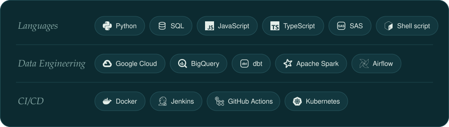
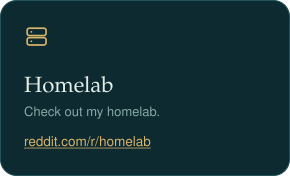
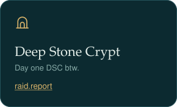
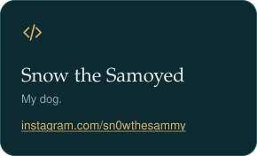

  

  

  

  

<table align="center" width="100%">
  <tr>
    <td width="33.33%" align="center"></td>
    <td width="33.33%" align="center"></td>
    <td width="33.33%" align="center"><a href="https://www.instagram.com/sn0wthesammy/"></td>
  </tr>
</table>

----
